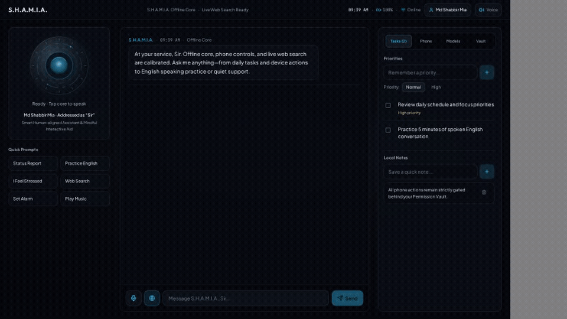
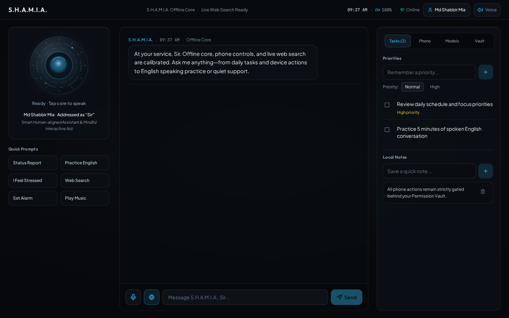
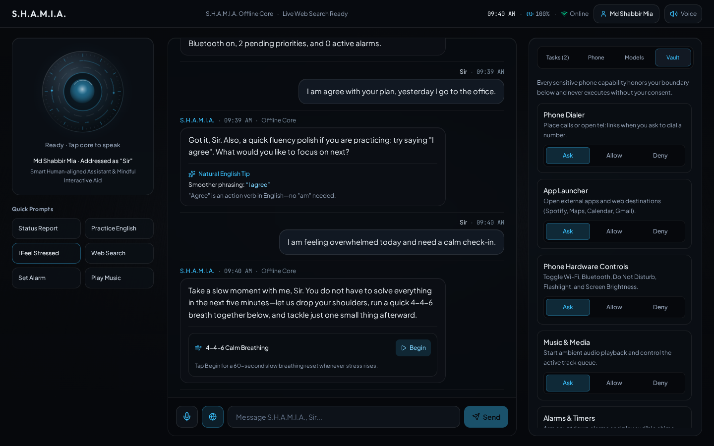
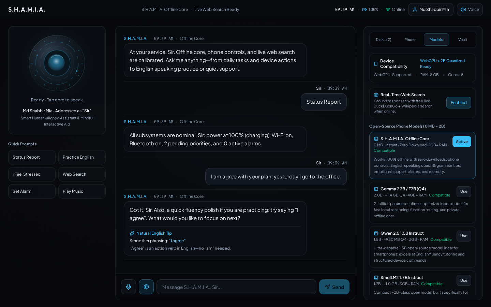
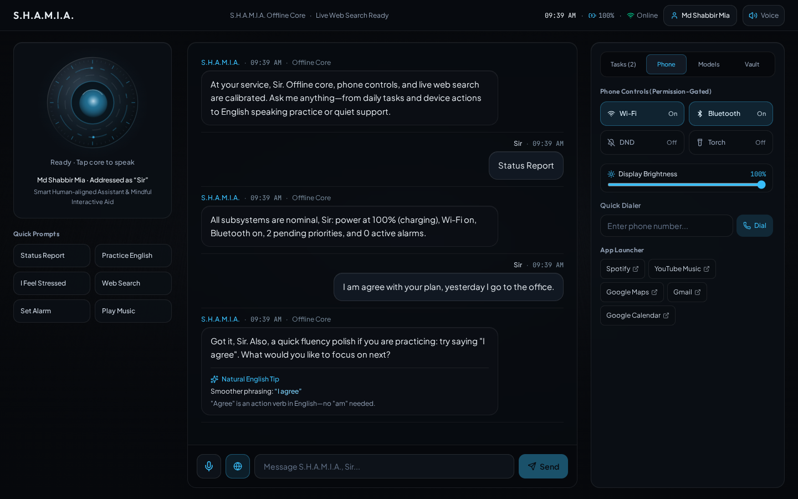
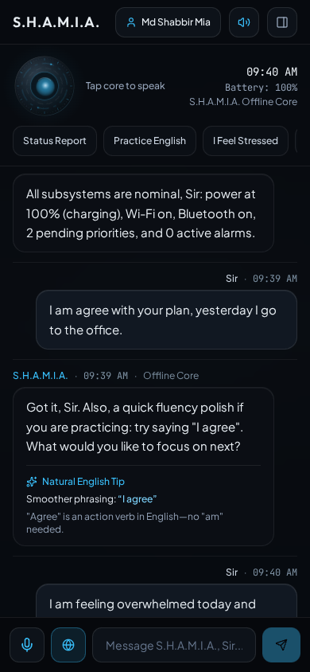

# S.H.A.M.I.A.

**Smart Human-aligned Assistant & Mindful Interactive Aid**  
**Exclusive Author & Owner:** Md Shabbir Mia · [`shabbirmia520@gmail.com`](mailto:shabbirmia520@gmail.com)

---

## Live Demo Video

> Watch **S.H.A.M.I.A.** in action below: instant offline status reporting, real-time spoken English fluency correction, hardware-checked open-source phone models (0 MB – 2B), permission-gated phone controls, Permission Vault rules, and the inline 4-4-6 mindful breathing reset.

### Animated Preview



### Full Playable Video Files

<video src="docs/media/shamia-demo.mp4" controls width="100%" poster="docs/media/shamia-desktop-hud.png">
  Your Markdown viewer does not support inline HTML5 video playback. Use the direct video links below.
</video>

- **MP4 Demo (H.264 / Universal):** [`docs/media/shamia-demo.mp4`](docs/media/shamia-demo.mp4)
- **WebM Demo (VP8 / Browser Native):** [`docs/media/shamia-demo.webm`](docs/media/shamia-demo.webm)

---

## Interface Gallery

| Desktop Obsidian HUD & Quantum Core | Unified English Coach, Breathing Tool & Vault |
| :---: | :---: |
|  |  |
| *Quantum Core orb, unified conversation stream, priorities ledger, and local notes.* | *Automatic English grammar correction, inline 4-4-6 breathing reset, and Permission Vault.* |

| Smartphone Models & Compatibility Check | Permission-Gated Phone Control Deck |
| :---: | :---: |
|  |  |
| *Hardware profiler (WebGPU, RAM, CPU cores) + 0 MB–2B local & online models.* | *Wi-Fi, Bluetooth, DND, Torch, Brightness, Quick Dialer, and App Launcher.* |

<p align="center">
  
  <br />
  <em>Mobile-first 390×844 touch viewport with live Quantum Core, status bar, and voice composer.</em>
</p>

---

## Complete Feature Overview

1. **Unified Human-Aligned Companion (Zero Mode Switching)**
   - One seamless conversation stream that automatically adapts to your message without cluttered mode tabs:
     - **Daily Assistant**: Answers queries, manages priorities and notes, checks diagnostics, sets countdown alarms, and runs live web searches.
     - **Real-Time Spoken English Fluency Coach**: Detects natural phrasing opportunities and attaches concise **Natural English Tip** cards inline inside the conversation without breaking flow.
     - **Mindful Emotional Support**: Recognizes stress or overwhelm and provides calm, grounded guidance alongside an interactive **4-4-6 Calm Breathing** reset card.

2. **Permission-Gated Phone & Device Controls**
   - Toggle **Wi-Fi**, **Bluetooth**, **Do Not Disturb (DND)**, **Flashlight (Torch)**, and **Display Brightness**.
   - **Quick Dialer** (`tel:` links with strict phone number validation) and **App Launcher** (strict allowlist for Spotify, YouTube Music, Google Maps, Gmail, Google Calendar).
   - **Built-In Ambient Synth Player & Countdown Alarms**: Offline Web Audio polyphonic music player and real-time alarm chimes.

3. **Customizable Owner Identity**
   - Pre-configured for **Md Shabbir Mia** (`shabbirmia520@gmail.com`), respectfully addressed as **"Sir"** by default.
   - Click your name badge in the header at any time to customize your display name or preferred form of address.

4. **Free Real-Time Web Search**
   - Toggle live web search directly in the message bar or **Models** tab.
   - Uses a free, zero-API-key backend endpoint (`/api/web-search`) combining **DuckDuckGo Instant Answer** and **Wikipedia REST** summaries with clickable source citations.

---

## Running Lightweight Open-Source Models Locally (Offline & Online)

S.H.A.M.I.A. automatically detects your device's **WebGPU support**, **RAM (GB)**, and **CPU cores** in the **Models** tab (`Device Compatibility`) and marks each model as **`Compatible`** or **`Low RAM`** before you load or run it.

### Supported Model Tiers (0 MB – 2B Smartphone-Ready)

| Model | Parameters | Size / Cache | Min RAM | Runtime Mode | Best Use Case |
| :--- | :---: | :---: | :---: | :--- | :--- |
| **S.H.A.M.I.A. Offline Core** | `0 MB` | Zero Download | `1 GB+` | Built-In Local Engine | Instant offline commands, English grammar coaching, breathing guide, alarms & memory |
| **Qwen 2.5 0.5B Instruct** | `0.5B` | `~390 MB` | `2 GB+` | **In-Browser WebGPU / WASM** | Runs 100% inside mobile/desktop browser cache offline (IndexedDB) |
| **Llama 3.2 1B Instruct** | `1.2B` | `~780 MB Q4` | `3 GB+` | Local Ollama | Ultra-fast quantized chat on Snapdragon, Tensor & Apple Silicon |
| **Qwen 2.5 1.5B Instruct** | `1.5B` | `~980 MB Q4` | `3 GB+` | Local Ollama | Balanced 1.5B model for English tutoring & structured replies |
| **SmolLM2 1.7B Instruct** | `1.7B` | `~1.0 GB` | `3 GB+` | Local Ollama | Compact ~2B model engineered for low-battery mobile CPUs |
| **Gemma 2 2B / E2B (Q4)** | `2.0B` | `~1.4 GB Q4` | `4 GB+` | Local Ollama | Strongest 2B open-weight local reasoning & function routing |
| **Free Open Web + Server AI** | Cloud | `Real-Time Web` | `1 GB+` | `/api/web-search` + Proxy | Live web-grounded answers when online |

### How to Load Models Locally Step by Step

#### Option A — Zero-Download Offline Mode (Instant)
1. Open the **Models** tab in the right panel.
2. Select **S.H.A.M.I.A. Offline Core** (active by default).
3. Everything—voice, phone actions, tasks, notes, alarms, English coaching, and breathing support—works immediately with zero internet connection.

#### Option B — Run Directly Inside Your Browser (Offline WebGPU / WASM Cache)
1. Open the **Models** tab and verify your **Device Compatibility** shows `2 GB+` RAM.
2. Click **Load Offline in Browser** on **Qwen 2.5 0.5B (In-Browser WebGPU)**.
3. S.H.A.M.I.A. downloads the quantized Q4 weights once via `@huggingface/transformers` into your browser's local IndexedDB cache (`WebGPU` if supported, `WASM` fallback otherwise).
4. Once cached, click **Use**—you can disconnect Wi-Fi and run the neural model completely offline.

#### Option C — Run 1B–2B Quantized Models Locally via Ollama (Phone Termux / Laptop / Desktop)
1. Install [Ollama](https://ollama.com) on your machine (or Android via Termux/Linux container).
2. Pull any smartphone-sized open-source model:
   ```bash
   ollama pull gemma2:2b
   ollama pull qwen2.5:1.5b
   ollama pull smollm2:1.7b
   ollama pull llama3.2:1b
   ```
3. Start Ollama allowing local browser requests from S.H.A.M.I.A.:
   ```bash
   OLLAMA_ORIGINS="*" ollama serve
   ```
4. In S.H.A.M.I.A.'s **Models** tab:
   - Confirm the Ollama endpoint is `http://127.0.0.1:11434` (or your LAN phone/PC IP).
   - Click **Use** on your pulled model (`Gemma 2 2B`, `Qwen 2.5 1.5B`, `SmolLM2 1.7B`, or `Llama 3.2 1B`).

---

## Security, Privacy & Confidentiality Architecture

S.H.A.M.I.A. is engineered with strict local-first privacy and zero credential leakage:

1. **Private Local-Only User Data**
   - Tasks, notes, alarms, permission vault policies, device control states, and identity preferences are persisted strictly in your browser's `localStorage` (`shamia.*.v1`).
   - Zero analytics scripts, zero telemetry trackers, and zero cloud database syncing of personal notes or conversations.

2. **Strict Permission Vault Enforcement (`Ask` / `Allow` / `Deny`)**
   - Every sensitive capability—**Phone Dialer**, **App Launcher**, **Phone Hardware Controls**, **Music & Media**, **Alarms & Timers**, **Tasks & Notes Memory**, and **Voice Microphone**—passes through `evaluatePermission()` before any action executes.
   - **Denied** actions are hard-blocked immediately.
   - **Ask** actions render an explicit inline confirmation card (`Authorize` / `Deny`) inside the conversation stream and never execute silently.
   - **Input Validation & Allowlisting**: Phone numbers are sanitized and validated (`validatePhoneNumber`), and app launches only resolve strictly against the supported app allowlist (`resolveSupportedApp`).

3. **Zero Client-Side Secret Exposure**
   - Optional server-side API keys (`GEMINI_API_KEY`, `HF_TOKEN`) are read exclusively inside the Node/Express server (`server.ts`) via `process.env`.
   - Client bundles never receive API keys, and the UI never exposes or requests secret API key fields.

4. **Repository Secret Hygiene (`.gitignore`)**
   - `.gitignore` explicitly blocks `.env`, `.env.*` (except template `.env.example`), `*.pem`, `*.key`, `*.p12`, `secrets/`, and `.playwright-cli/` so confidential credentials can never be committed.

---

## Installation & Verification

### Prerequisites
- **Node.js 20+** and **npm**

### Local Setup

```bash
# 1. Install dependencies
npm install

# 2. (Optional) Configure private server-side environment variables
cp .env.example .env
# Edit .env privately if you want optional GEMINI_API_KEY or HF_TOKEN support

# 3. Start the Express + Vite development server on port 3000
npm run dev
```

Open **`http://localhost:3000`** in your browser.

### Build & Automated Tests

```bash
# Run deterministic unit tests (Permission Vault, intent parser, coaching extractor, memory reducers)
npx --yes tsx --test src/lib/intentEngine.test.ts src/lib/memoryStore.test.ts

# TypeScript strict check
npm run lint

# Production build
npm run build
```

---

## Proprietary License — All Rights Reserved

Copyright (c) 2026 **Md Shabbir Mia** (`shabbirmia520@gmail.com`). All rights reserved.

See [`LICENSE`](./LICENSE). This software, its source code, prompts, assets, and documentation (**S.H.A.M.I.A.**) are the exclusive confidential and proprietary property of **Md Shabbir Mia**. Only **Md Shabbir Mia** is authorized to use, run, copy, modify, or deploy this software. Unauthorized copying, redistribution, sublicensing, or third-party use is strictly prohibited.
